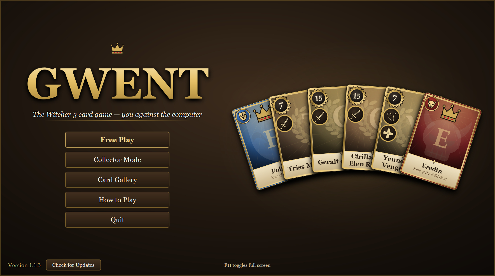
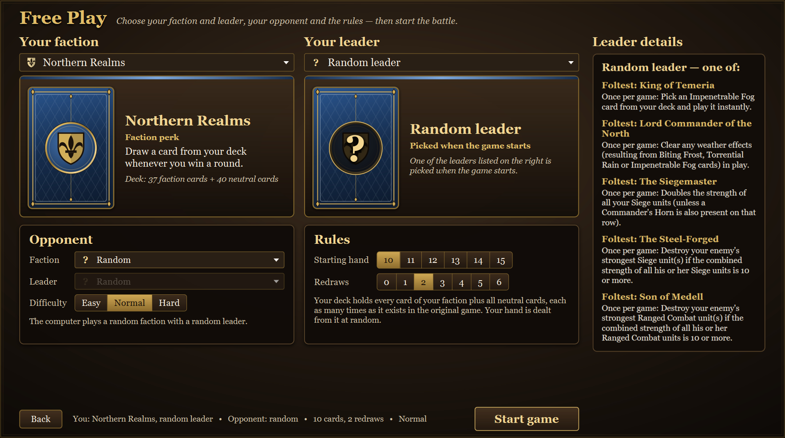
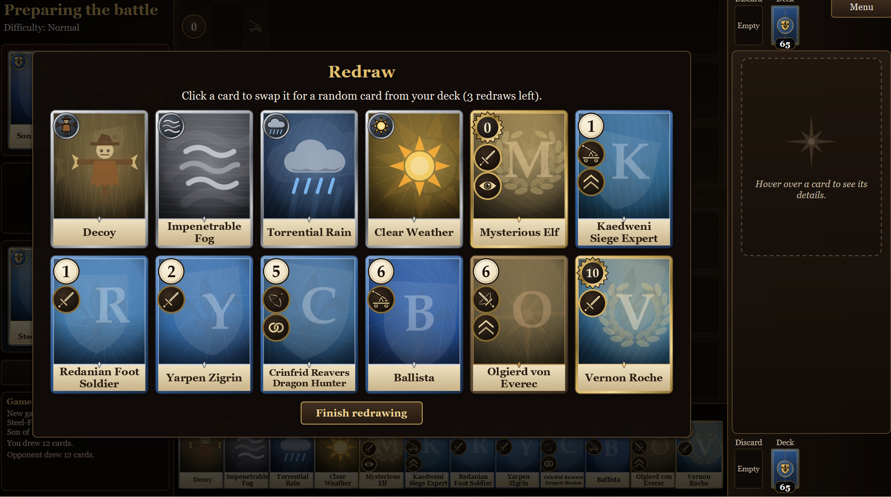
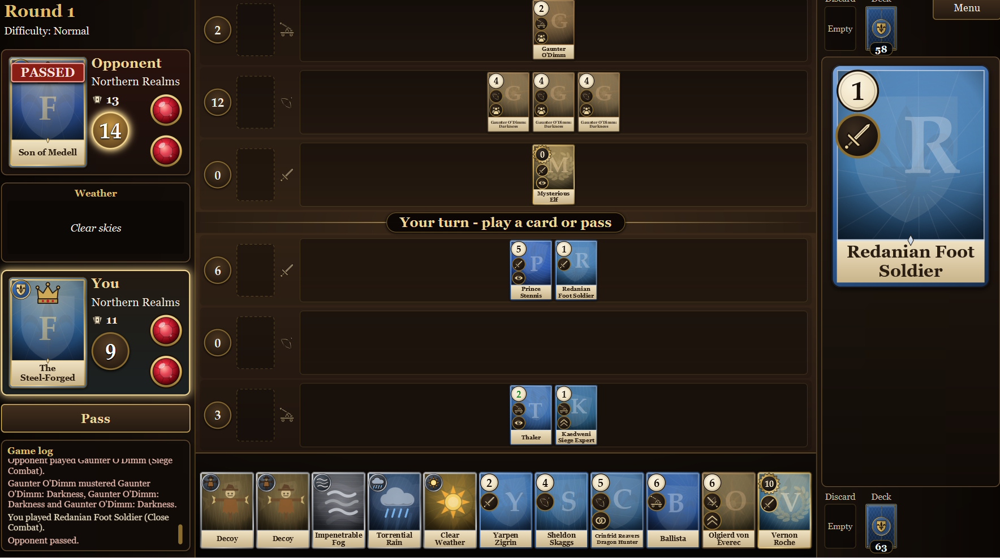

# GwentFX

A fan-made remake of the original **Witcher 3 in-game Gwent** as a standalone JavaFX game: you against the computer, with all
five factions (Northern Realms, Nilfgaard, Scoia'tael, Monsters, Skellige), every leader, hero, special
card and weather card. You own every card from the start, and your starting hand is dealt at random from
your faction's cards plus the neutral cards.

See [RULES.md](RULES.md) for how the original rules were interpreted, and [AI.md](AI.md) for how the computer
opponent makes its decisions.

## Screenshots



*The main menu.*



*The New Game screen: faction, leader, opponent and rules.*



*Redrawing cards before the first round.*



*A game in progress.*

## Disclaimer

**This is an unofficial fan work and is not approved or endorsed by CD PROJEKT RED.** No copyright infringement is
intended.

- It's a free, non-commercial hobby project: it isn't sold, and nothing in it is behind a paywall.
- It uses no assets from the game: no artwork, music, sound or code. The card visuals are generated by the program.
- Card names, strengths and ability texts follow the original game, so that it plays the same. They belong to
  CD PROJEKT S.A., like everything else from the game, and this repository grants no rights to them.
- *The Witcher* and *Gwent* are trademarks of CD PROJEKT S.A.
- If CD PROJEKT RED or another rights holder objects to anything here, please open an issue and it will be removed.

## Download

Ready-to-play builds for Windows, macOS (Apple Silicon) and Linux are on the
[Releases](https://github.com/numankaraaslan/GwentFX/releases) page. Java is bundled, so there is nothing to install.

- **Windows:** unzip `GwentFX-<version>-windows-x64.zip` and run `GwentFX\GwentFX.exe`. SmartScreen may warn that the
  app is unrecognized because it isn't signed: click *More info*, then *Run anyway*.
- **macOS:** unzip `GwentFX-<version>-macos-arm64.zip` and open `GwentFX.app`. The app isn't signed, so the first time,
  right-click it and choose *Open*, or run `xattr -cr GwentFX.app` in a terminal. Intel Macs can run the game from source.
- **Linux:** run `tar -xzf GwentFX-<version>-linux-x64.tar.gz`, then `./GwentFX/bin/GwentFX`. It needs a desktop with GTK 3.

## Requirements

To build and run from source:

- JDK 25
- Maven 3.9+

## Run

```bash
mvn javafx:run
```

Or build a single runnable jar:

```bash
mvn -DskipTests package
java -jar target/GwentFX.jar
```

## How to play (short version)

- Best of three rounds. Each player has two gems (lives); losing a round costs one.
- On your turn, play one card or use your leader ability, or pass for the rest of the round.
  The round ends when both players have passed, and the higher total strength wins it.
- **Click** a card in your hand, then click one of the highlighted targets (a row, a horn slot, or a
  card for Decoy). Click the card again if it has only one possible target.
  Right-click or **Esc** cancels the selection.
- Click your **leader** to use its ability once per game.
- **Hover** over any card to see its details on the right.
- The **How to Play** screen in the main menu explains every ability, faction perk and special card.
  The **Card Gallery** shows every card.
- **F11** toggles full screen.

## New game options

On the New Game screen you choose your faction and leader (or a random leader). You can also change:

- the starting hand: 10–15 cards (default 10, as in the original);
- the number of redraws: 0–5 (default 2, as in the original);
- the opponent's faction and leader (default random);
- the difficulty: Easy, Normal or Hard (default Normal).

## Not included

- Deck building: your deck is always your faction's full collection plus every neutral card, at the original
  game's copy counts.
- Multiplayer, and saving or loading a game.
- Sound and music.
- Card artwork: the cards are drawn by the program.

## Technical overview

- Java 25 and JavaFX 25, built with Maven. Gson loads the card data.
- The rules engine contains no UI code. It runs the game on its own thread and publishes each step as a read-only
  copy of the game state, which the UI then animates.
- The computer opponent tries every possible move with the real rules engine and scores the results.
  [AI.md](AI.md) explains it in full.
- The only image files in the game are the app icon (`gwentfx-icon.jpg` in the resources, `gwentfx-icon.ico` in
  `packaging/`). The README screenshots in `screenshots/` are not part of the build.
  Cards are drawn with JavaFX shapes, all styling is in CSS files, and every screen is laid out on a 1920×1080
  canvas that scales to the window.
- All cards and leaders are defined in `src/main/resources/com/numankaraaslan/gwent/data/cards.json` and
  `leaders.json`; edit them to change cards.

## Releasing

The downloads are built by GitHub Actions ([release.yml](.github/workflows/release.yml)). To publish a version, push a
tag that starts with `v`:

```bash
git tag v1.0.0
git push origin v1.0.0
```

This builds the game on Windows, macOS and Linux with `jpackage` and attaches the three archives to a new GitHub
Release, with notes generated from the commits.

- The version in the file names comes from the tag. A tag with a suffix, such as `v1.2.0-beta1`, is marked as a
  pre-release. Use version 1.0.0 or higher, because macOS packaging rejects a major version of 0.
- Running the workflow by hand from the Actions tab builds the same archives and keeps them as workflow artifacts,
  without publishing a release.
- The app icon is the JPG in the resources (also the window icon in the game) and the `.ico` in `packaging/`. To change
  it, replace both files.

## License

The source code is released under the [MIT License](LICENSE). The license covers only the code written for this
project, not the names, card texts or anything else from the original game (see [Disclaimer](#disclaimer)).
